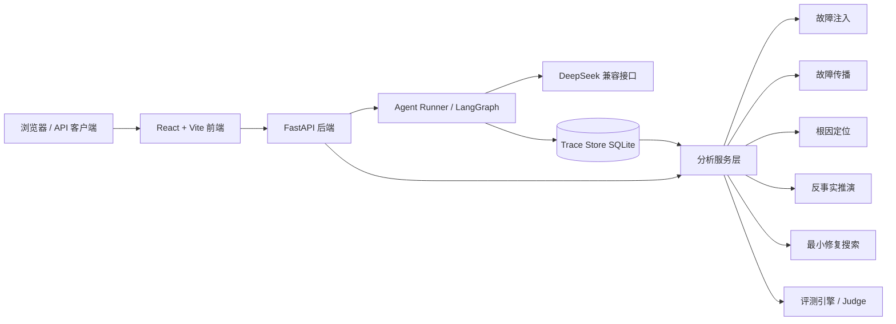

# TracePilot

TracePilot 是一个面向 AI Agent 的可观测性与可靠性实验平台：采集 Agent 执行轨迹、把异构日志标准化为可比较的 Trace、用 DAG 还原执行链路，并在可控的故障注入下分析故障传播、定位根因、做反事实推演与最小修复验证。

它解决的问题是：Agent 出错时，开发者通常只能看到一段"最终回答不对"的日志。TracePilot 把一次执行拆成可回放、可对比、可干预的结构化轨迹，让"为什么错、错在哪、改哪一步最有效"变成可以实验的问题。

## 核心功能

| 能力 | 说明 |
|---|---|
| Agent 执行轨迹采集 | 记录每一步工具调用、提示词、模型输出、耗时与 Token |
| Trace 标准化 | 统一为带节点/边的 schema，支持派生轨迹与证据血缘 |
| DAG 执行链路可视化 | 前端以节点图展示调用链与耗时、状态 |
| 故障注入 | 在指定步骤注入超时、异常、错误参数等故障 |
| 故障传播分析 | 分析故障沿调用链的扩散路径与影响面 |
| 根因定位 | 基于传播路径与证据血缘给出候选根因 |
| 反事实分析 | 假设某一步不同，重新推演结果差异 |
| 最小修复搜索 | 搜索改动最小的修复方案并验证 |
| 修复验证 | 对修复前后轨迹做对比与回归检测 |
| Bad Case 归因 | 把失败样本归因到具体能力与步骤 |
| 评测中心 | 评测集、版本对比、判分与质量门禁 |
| LLM Judge | 单/多评判器、校准与一致性分析 |
| 数据治理 | 证据血缘、数据版本与质量门禁 |

## 技术栈

- **后端**：Python 3.11、FastAPI、SQLAlchemy + SQLite、Pydantic
- **Agent 运行时**：LangGraph、LangChain、DeepSeek / OpenAI 兼容接口
- **前端**：React 19、TypeScript、Vite、@xyflow/react（DAG 图）、Axios
- **质量**：Pytest（49 个测试文件）、Playwright E2E、CI 质量门禁脚本
- **部署**：Docker / Docker Compose、Nginx 静态托管

## 系统架构



## 核心技术实现

1. **Trace 标准化**：把不同来源的执行记录归一为节点（步骤、工具、模型调用）与边（调用关系、数据流），并保留原始证据的引用路径，便于反查。
2. **DAG 还原**：以节点图重建一次执行的真实链路，支持按节点查看输入、输出、耗时与错误，前端用拓扑布局展示。
3. **故障注入与传播**：在指定节点注入受控故障，比较注入前后的轨迹，观察异常如何沿边传播，输出受影响节点集合。
4. **反事实与最小修复**：以"改变某一步"为前提重新执行或推演，比较结果差异；在候选修复中按改动范围排序并做回归验证。
5. **评测与门禁**：评测集 + 版本对比 + 判分校准，配合 CI 质量门禁脚本，防止指标回退。

## 目录结构

```
TracePilot/
├── backend/
│   └── app/
│       ├── main.py            # FastAPI 入口与路由
│       ├── agents/            # Agent 运行时
│       ├── services/          # 轨迹、故障、根因、评测等领域服务
│       ├── schemas/           # Pydantic 模型
│       └── tools/             # 工具定义
├── frontend/                  # React + Vite 工作台（含 e2e）
├── tests/                     # Pytest 用例
├── docs/                      # 架构、故障注入、评测等设计文档
├── config/                    # 运行配置
├── Dockerfile / docker-compose.yml
└── requirements.txt
```

## 本地运行

后端（Python 3.11）：

```bash
python -m venv .venv
. .venv/Scripts/activate        # Windows
pip install -r requirements.txt
python -m uvicorn backend.app.main:app --reload --port 8000
```

前端：

```bash
cd frontend
npm install
npm run dev                     # http://localhost:5173
```

真实模型调用需要自行在环境变量中提供 `DEEPSEEK_API_KEY`；不提供时相关功能保持关闭，不会产生费用。

## Docker 部署

```bash
docker compose up --build       # 后端 8000，前端 8080
```

## API 说明

后端提供轨迹、故障、反事实、修复、评测等 REST 接口，启动后访问：

```
http://127.0.0.1:8000/docs
```

典型流程：创建/导入轨迹 → 查看 DAG → 注入故障 → 分析传播 → 定位根因 → 反事实对比 → 修复验证。

## 实验结果

本项目未发布公开 Benchmark。真实可复现的数据是自动化测试结果（见下节）；其余性能数据以本地运行日志为准，不做量化宣称。

## 自动化测试

```bash
python -m pytest -q
```

当前本机实测（2026-11-25，Python 3.11）：**704 passed / 17 failed**。失败集中在回放、故障传播、Token 统计等依赖种子数据与真实模型接口的用例，属于需要补充 fixture/凭据的已知缺口，尚未修复，因此不作为"全部通过"对外描述。

前端 E2E：`cd frontend && npm run test:e2e`（Playwright）。

## 在线演示

暂无公网部署。仓库内含 Docker 与 `render.yaml` 配置，可自行部署。

## 已知局限

- 17 项测试依赖真实模型接口与种子数据，本地未全部通过。
- 评测指标与判分结果尚未做公开数据集上的对照实验。
- 单机 SQLite 存储，未做多租户与水平扩展。
- 前端 e2e 仅覆盖桌面视口。
