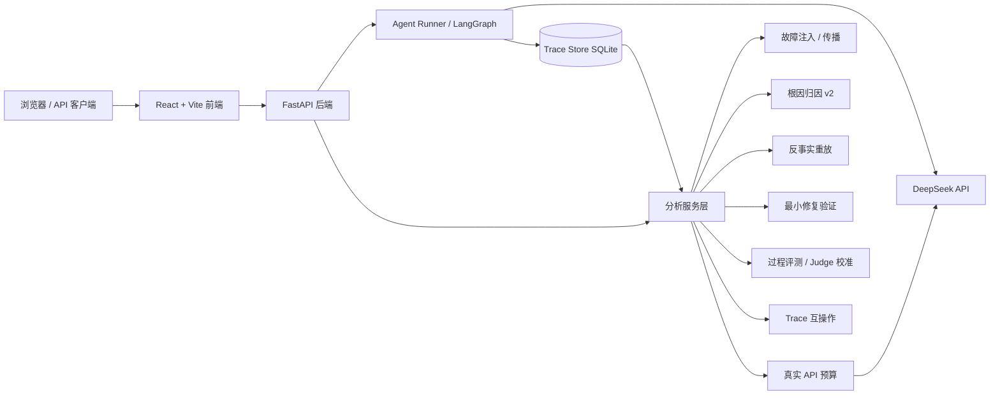

# TracePilot

TracePilot 是一个面向真实长程 Agent 的**过程评测、故障归因与反事实修复验证平台**。

它解决的问题是：Agent 失败时，开发者通常只能看到一段"最终回答不对"的日志。TracePilot 把一次执行拆成
可回放、可对比、可干预的结构化 Trace，在此基础上回答三个工程问题——

1. **过程好不好**：每一步的工具调用、模型决策、证据链是否符合任务与策略要求；
2. **错在哪一步、为什么错**：故障传播路径、根因候选排序、证据血缘；
3. **改哪一步最有效**：受控反事实重放与最小修复验证，用真实重放结果而不是模型自述来判定是否修好。

在线演示：<https://www.modelscope.cn/studios/luis123XI394/TracePilot>
（ModelScope 创空间，免费 CPU 环境；真实模型调用受持久预算限制，详见下文"真实/模拟边界"）

## 核心能力

| 能力 | 说明 |
|---|---|
| Agent 真实执行 | DeepSeek Function Calling 多步执行，记录模型调用/工具调用/Token/延迟 |
| Trace 标准化 | 统一 schema（节点 + 边 + 证据血缘），支持派生轨迹与外部 Trace 导入 |
| DAG 执行链路 | 前端节点图展示调用链、耗时、状态、父节点关系 |
| 过程评测 | 确定性规则 + LLM Judge + 多 Judge 一致性 + 版本对比，评的是过程不是最终答案 |
| 故障注入与传播 | 在指定节点注入超时/异常/错误参数/结果污染，分析异常沿边的扩散 |
| 根因归因 | 三组方法：确定性规则、LLM 直接诊断、规则+DAG+证据血缘+LLM 裁决 |
| 反事实分析 | 干预某一步后重放，对比前后 Trace；区分 mock/replay 与真实 API 执行 |
| 最小修复验证 | 候选修复（参数/重试/超时/上下文/节点重跑）在受控执行（工具白名单 + 有界步数）环境中真实重放验证 |
| 公开 Benchmark | Microsoft AgentRx 公开子集接入，开发/测试集严格隔离，标签不进 Prompt |
| Trace 互操作 | QueryForge Trace 协议 v1（JSON Schema + 校验 + 导入 + 可视化） |
| 成本与预算 | 按每次上游调用扣减的持久化预算，Token/延迟/估算费用统计，超支保护 |

## 技术栈

- **后端**：Python 3.11、FastAPI、SQLAlchemy + SQLite、Pydantic v2
- **Agent 运行时**：LangGraph / LangChain、OpenAI 兼容 SDK（DeepSeek）
- **前端**：React 19、TypeScript、Vite、@xyflow/react、Playwright
- **质量**：Pytest（58 个测试文件）、CI 质量门禁脚本、真实 API Smoke（独立运行）
- **部署**：Docker / docker-compose、ModelScope 创空间

## 系统架构



### Agent 执行范式：Plan-and-Execute

Agent 执行采用 **Plan-and-Execute**：`understand（理解任务）→ plan（生成显式计划）→ agent/tools 循环（按计划执行）→ 结论`，
实现见 `backend/app/agents/basic_agent.py`（LangGraph 状态图：understand / plan / agent / tools）。

- 计划是**显式产物**：先产出编号步骤列表，再进入执行循环，便于 Trace 回放、过程评测与根因归因；
- 工具调用走**受控执行（工具白名单 + 有界步数）**：只允许注册的本地无副作用工具，模型调用轮数、工具轮数、
  Token 与墙钟时间由 `backend/app/services/execution_config.py` 的 production/local 档位硬限制；
- 不采用"推理与行动在同一轮内隐式交替"的范式：计划与执行在 Trace 中是可分开观察的两个阶段。

## 真实 / 模拟边界（工程约束，不是宣传语）

真实模型调用按"每次上游调用"计量和扣减预算，状态持久化到磁盘，重启不清零：

- 每条 Trace 带 `execution_mode`（`real_api` / `mock` / `simulated` / `replay`）与 `metadata.data_source`；
- 真实调用记录 Provider 上报的 usage、模型名、延迟；拿不到 Token 时写 `null`/`unknown`，**不填 0**；
- 反事实/修复模块在代码层**拒绝**非 `real_api` 结果参与"修复成功"判定；
- 预算总量与访客日额度双限制，调用前 reserve、返回后记账；状态损坏时 fail-closed（拒绝调用）；
- 普通测试全部使用 fake client，不依赖付费凭据；真实 API 测试独立运行并设预算上限。

## 可观测性导出（可选，默认关闭）

支持把本地 Trace 以 **OTLP/HTTP**（OpenTelemetry Protocol）标准协议增量导出到自托管 LangFuse：

- 两条通道：**官方 `langfuse==5.2.0` SDK**（已加入 `requirements.txt`，生产接入）与**内置 OTLP 通道**
  （仅标准库、零新增依赖，最小化环境/离线审计用）；
- 默认关闭：`TRACEPILOT_LANGFUSE_ENABLED=1` 或 CLI `--yes` 才真实发送；否则只做 dry-run；
- 支持增量（Trace 内容指纹）、幂等（确定性 traceId/spanId）、重试、并发锁、失败不推进状态；
- 通用 OTel 字段（`service.name`、`gen_ai.*`）+ LangFuse 观测属性（`langfuse.observation.*`）。

```bash
# 只生成 OTLP 负载（审阅用，不发网络）
python scripts/export_langfuse.py --dry-run --limit 10

# 真实导出到自托管 LangFuse
LANGFUSE_HOST=http://localhost:3000 \
LANGFUSE_PUBLIC_KEY=pk-... LANGFUSE_SECRET_KEY=sk-... \
python scripts/export_langfuse.py --yes
```

详见 `docs/OBSERVABILITY_LANGFUSE.md`；只读状态接口：`GET /api/observability/langfuse`。

## 实验结果（全部来自实际运行）

### 真实 API 全链路验收

| 项目 | 实际结果 |
|---|---|
| 真实 Agent 多步执行 | 4 段 model_call，真实 calculator 工具调用，3,202 in / 628 out / 3,830 total tokens |
| 真实受控反事实 | `remove_fault` 重放成功，3,626 tokens，7.3s，因果证据等级 `weak` |
| 真实最小修复验证 | `INCREASE_TIMEOUT`、`LIMITED_RETRY` 两个候选真实重放通过 |
| 真实 Judge 校准 | 16 案例（13 可评估）：exact 0.3077、MAE 0.9192、within-1 0.6154 |
| 预算执行 | 142 次上游调用，369,830 in / 58,278 out tokens，按配置单价估算 ¥0.486（非 Provider 账单），无超支 |

### AgentRx 公开 Benchmark 三组对照（25 条 test 案例，真实 DeepSeek 调用）

| 指标 | Baseline B 规则 | Baseline A 直接 LLM | TracePilot V2 |
|---|---:|---:|---:|
| Root Cause Top-1 | 0.04 | **0.32** | 0.20 |
| Root Cause Top-3 | 0.08 | 0.32 | **0.40** |
| Failure Step Accuracy | 0.08 | **0.48** | 0.36 |
| Category Macro-F1 | 0.0351 | 0.0873 | **0.0926** |
| 平均延迟 | 0 ms | 1,293.9 ms | 1,596.6 ms |

**如实结论**：V2 在当前样本上 **Top-1 没有超过直接 LLM 诊断**（0.20 vs 0.32），不宣称架构更优；
Top-3 的提升部分来自输出格式差异（Baseline A 只给单答案），不作为独立优势；v2.1 Prompt 在同一批
案例上调过，无独立验证集，存在过拟合风险。失败原因分析见 `docs/V2_BAD_CASE_ANALYSIS.md`。

## 自动化测试

```bash
.venv/Scripts/python.exe -m pytest -q      # Windows；需项目 venv（Python 3.11）
```

当前实测（2026-11-28，Python 3.11.5）：**906 passed**，0 failed。
真实 API 测试不在默认套件中（避免付费），需显式配置 `.env` 与预算后单独运行。

前端浏览器 E2E（Playwright + 系统 Edge，108 项）：**108 passed / 0 failed**（193.6s）。
运行前置（后端 8000 + Vite 5173、两个受控 fixture Trace）见 `frontend/e2e/README.md`。

## 本地运行

```bash
python -m venv .venv
.venv/Scripts/activate                 # Windows
pip install -r requirements.txt
python -m uvicorn backend.app.main:app --reload --port 8000
```

前端：

```bash
cd frontend
npm install
npm run dev                            # http://localhost:5173
```

不配置 `DEEPSEEK_API_KEY` 时，真实模型相关功能保持关闭且不产生费用；模拟/回放功能仍可用。
`.env.example` 列出全部可选配置（预算上限、访客额度、单价、管理员令牌等）。

## Docker 部署

```bash
docker compose up --build              # 后端 8000，前端 8080
```

ModelScope 创空间部署说明见 `docs/PUBLIC_DEPLOYMENT.md`；
生产发布必须遵守 `docs/SAFE_DEPLOY_AND_RELEASE.md`（含回滚与健康门禁）。

kind 单节点集群（本地验证用，不影响魔搭线上）：

```bash
docker build -f deploy/k8s/Dockerfile -t tracepilot:local .
kind create cluster --config deploy/k8s/kind-config.yaml
kind load docker-image tracepilot:local --name tracepilot
kubectl apply -k deploy/k8s
kubectl -n tracepilot rollout status deploy/tracepilot --timeout=180s
curl -fsS http://localhost:8080/api/health
```

详见 `deploy/k8s/README.md`。

## 项目结构

```
TracePilot/
├── backend/app/
│   ├── main.py                 # FastAPI 入口与路由（160 个接口）
│   ├── agents/                 # Agent 运行时（Plan-and-Execute，LangGraph）
│   ├── services/               # 轨迹/故障/归因/反事实/评测/预算/互操作
│   ├── schemas/                # Pydantic 模型（含 QueryForge Trace 协议）
│   └── security.py             # 管理员令牌 + HMAC 签名 Cookie
├── frontend/src/               # React 工作台（22 个页面）
├── tests/                      # 58 个测试文件，906 项用例
├── data/benchmarks/agentrx/    # AgentRx 公开子集（含 LICENSE 与 manifest）
├── deploy/k8s/                 # kind 单节点 K8s 清单、构建镜像与验证说明
├── docs/                       # 架构、评测、归因、协议、部署、可观测性、V2 报告
└── requirements.txt / Dockerfile / docker-compose.yml
```

## 文档

| 文档 | 内容 |
|---|---|
| `docs/V2_ENGINEERING_REPORT.md` | V2 工程改动、真实 API 验收、回归结果 |
| `docs/V2_BENCHMARK_REPORT.md` | AgentRx 数据来源、划分、三组对照完整数据 |
| `docs/V2_BAD_CASE_ANALYSIS.md` | 归因失败样本逐例分析与诚实结论 |
| `docs/TRACE_INTEROPERABILITY.md` | QueryForge Trace 协议 v1 与导入流程 |
| `docs/INTERVIEW_GUIDE.md` | 项目讲解口径、高频问答、简历条目 |
| `docs/TERMINOLOGY.md` | 术语规范、禁用词→标准词映射与例外、JD 术语对照 |
| `docs/OBSERVABILITY_LANGFUSE.md` | Trace→Langfuse OTLP 增量导出、自托管接入与安全边界 |
| `docs/SAFE_DEPLOY_AND_RELEASE.md` | dev 分支→测试→docker→合并→魔搭发布/回滚的安全发布流程 |
| `deploy/k8s/README.md` | kind 单节点集群部署与验证步骤 |
| `docs/ARCHITECTURE.md`、`docs/TRACE_SCHEMA.md` | 系统架构与 Trace 数据契约 |
| `docs/AGENTRX_BENCHMARK.md` | Benchmark 适配与标签结构 |

## 术语规范（防雷）

本项目对易混术语有严格标准（完整映射与例外见 `docs/TERMINOLOGY.md`）：

| 场景 | 标准术语 |
|---|---|
| Agent 执行范式 | **Plan-and-Execute**（显式计划 + 执行循环） |
| 执行环境与安全边界 | **受控执行（工具白名单 + 有界步数）** |
| 评测编排 | **评测流水线** |
| 可观测性 | **OTLP/HTTP 导出**（OpenTelemetry Protocol） |

```bash
python scripts/check_terminology.py     # 禁用词检查（CI 已接入）
```

> 特别说明：前端框架 **React** 与 Agent 范式是不同概念，检查器使用大小写敏感匹配，不会误伤 React 代码。

## 标准 JD 术语映射

| 岗位 JD 术语 | 本项目对应实现 | 说明 |
|---|---|---|
| Plan-and-Execute / Agent 编排 | `backend/app/agents/basic_agent.py` | 显式 plan 节点 + 工具循环；执行受工具白名单与有界步数约束 |
| Workflow 编排 / Evaluation Pipeline | `backend/app/services/evaluation_pipeline.py`、`quality_gate.py` | 评测流水线编排（阶段/重试/取消/门禁）与质量门禁 |
| 造题 Pipeline | `backend/app/services/red_team_generator.py` | 确定性模板 + 种子变异生成对抗用例（造题流水线） |
| Root Cause Attribution (RCA) | `backend/app/services/rootcause_v2.py` | 规则 + DAG/证据血缘 + LLM 裁决的三组对照 |
| Observability / OTel | `backend/app/services/langfuse_export.py`、`langfuse_sdk_export.py` | Trace → OTLP → LangFuse 增量导出（含官方 SDK 通道） |
| Benchmark Adapter | `backend/app/services/agentrx_benchmark.py` | AgentRx 公开子集适配、dev/test 隔离 |
| Hybrid Search | `QueryForge-v2/app/bm25_engine.py`（BM25 稀疏通道）+ `QueryForge-v2/app/retrieval_service.py`（RRF 融合与权重） | **跨仓库**：兄弟项目 QueryForge 的检索实现，本平台通过 Trace 互操作协议对接 |
| 缓存一致性 | `QueryForge-v2/app/retrieval_cache.py`（Redis key 含索引快照版本 + 路由版本，版本变化自动失效） | **跨仓库**：同上 |
| Memory 管理 | `QueryForge-v2/app/session_memory.py`（会话记忆的读写/淘汰；本仓库以 `memory_read`/`memory_write` StepType 记录到 Trace） | **跨仓库**：同上 |

> 说明：`bm25_engine.py` / `retrieval_cache.py` / `session_memory.py` 不在 TracePilot 仓库内，
> 而是兄弟项目 **QueryForge** 的实现；TracePilot 侧对应的能力是 `trace_interop.py` 的 QueryForge Trace 协议对接、
> `memory_read` / `memory_write` 步骤语义与过程评测。

## 已知局限

- 根因归因未在独立验证集上验证泛化；样本 25 条，无显著性检验；
- Judge 校准的参考标签为开发者按 Rubric 给出的确定性参考（`synthetic_reference`），不是独立人工双盲标注；
- 成本为 Token × 配置单价估算，不等于 Provider 账单；
- AgentRx 仅使用公开 GitHub 子集 73 条（HF 完整版需授权，未使用）；
- 单机 SQLite 存储，未做多租户与水平扩展；前端 E2E 仅覆盖桌面视口与一条移动端回归。
