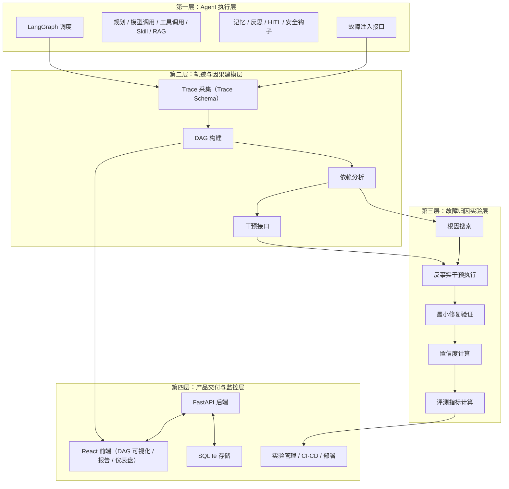
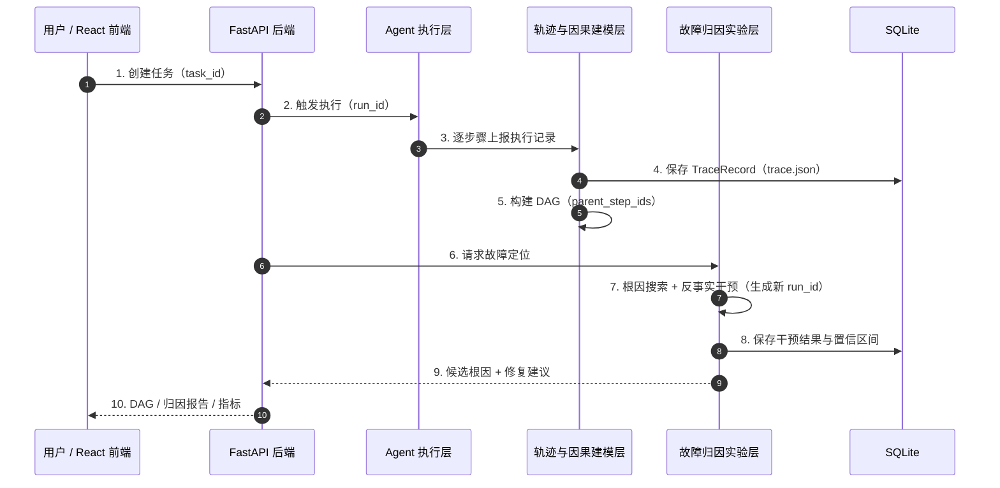
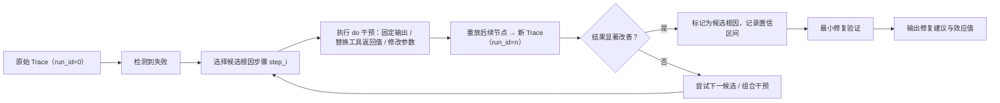

# TracePilot 系统架构设计文档

- 文档版本：v0.1（草案）
- 依据：`docs/PRD.md`（第 4.2 / 5.2 节）、`docs/TRACE_SCHEMA.md`、`backend/app/schemas/trace.py`
- 状态：架构设计（规划）；对应 PRD 阶段1。所有模块均为规划，尚未实现

> 本文档与 `docs/PRD.md`、`docs/TRACE_SCHEMA.md` 保持一致：四层架构沿用 PRD 第 5.2 节；数据模型以 `backend/app/schemas/trace.py` 为准，本文档不重新定义 Trace Schema，仅描述各层如何消费与产生该数据结构。

---

## 1. 系统总体架构

TracePilot 采用**四层架构**，自下而上依次为：Agent 执行层、轨迹与因果建模层、故障归因实验层、产品交付与监控层。层间通过明确的接口传递数据，核心数据载体为 `TraceRecord` / `TraceStep`（Pydantic 模型）。

**层间依赖原则**：上层依赖下层提供的接口，下层不感知上层；跨层数据一律以 Trace Schema 定义的 Pydantic 模型或 JSON 兼容 dict 传递，避免隐式耦合。

---

## 2. 四层模块职责

### 2.1 第一层：Agent 执行层

负责加载并执行 Agent，产出原始执行记录。

| 模块 | 职责 |
|------|------|
| LangGraph 调度 | 编排 Agent 执行流程（规划、工具调用、Skill、RAG 集成） |
| 规划 / 模型调用 / 工具调用 | 执行核心步骤，调用 DeepSeek API 与各类工具 |
| 记忆 / 反思 / HITL / 安全钩子 | 挂载记忆读写、反思重试、人工确认、安全过滤等能力 |
| 故障注入接口 | 在指定步骤注入错误（返回空数据、异常、垃圾上下文），供评测与归因使用 |

**对外输出**：每步的输入 / 输出 / 工具调用与结果 / 状态 / 耗时 / Token 消耗，交给第二层标准化采集。

### 2.2 第二层：轨迹与因果建模层

负责把执行记录标准化为 Trace，并建模为 DAG。

| 模块 | 职责 |
|------|------|
| Trace 采集 | 按 `TraceRecord` / `TraceStep` 模型规范化执行记录，持久化为 JSON |
| DAG 构建 | 依据 `TraceStep.parent_step_ids` 组装有向无环图 |
| 依赖分析 | 提取串行、并行、条件分支、收敛（fan-in）等结构关系 |
| 干预接口 | 在指定节点插入"假设结果"或"固定输出"，供第三层反事实实验调用 |

**对外输出**：`TraceRecord`（JSON）+ DAG（邻接表 / 图对象）+ 依赖关系，供归因与可视化使用。

### 2.3 第三层：故障归因实验层

负责基于 DAG 做因果归因与修复验证。

| 模块 | 职责 |
|------|------|
| 根因搜索 | 遍历 / 启发式搜索候选步骤，执行干预并比较结果 |
| 反事实干预执行 | 固定某步输出 / 替换工具返回值 / 修改参数，重放后续节点 |
| 最小修复验证 | 搜索最小干预集并反复验证失败是否消失 |
| 置信度计算 | 多次干预获得成功 / 失败分布，计算置信区间 |
| 评测指标计算 | 统计 Top-1/Top-3、修复成功率、误归因率、平均诊断成本、运行时间 |

**对外输出**：候选根因列表（含置信区间）、修复建议、评测指标，交给第四层展示与存储。

### 2.4 第四层：产品交付与监控层

负责对外服务、展示、存储与工程交付。

| 模块 | 职责 |
|------|------|
| FastAPI 后端 | 提供任务提交、执行触发、Trace/DAG 查询、干预、报告、指标接口 |
| React 前端 | 任务配置、执行监控、Trace DAG 可视化、归因报告、指标仪表盘 |
| SQLite 存储 | 持久化 Trace、步骤、任务、实验与指标（见第 7 节） |
| 实验管理 | 横向管理评测实验的配置、输入、输出、指标、成本，支持版本对比 |
| CI/CD 与部署 | GitHub Actions 持续集成；Docker 一键部署；安全策略 |

---

## 3. 核心数据流

一次完整的诊断闭环的数据流如下：

**关键点**：步骤 3–5 由第二层完成"轨迹 → DAG"建模；步骤 7–8 的每一次干预都产生一条**新的 TraceRecord**（新 `run_id`），用于与原始 Trace 做对比。

---

## 4. Trace Schema 与 DAG 的关系

数据模型见 `backend/app/schemas/trace.py`，此处仅说明其与 DAG 的映射：

| 概念 | Trace Schema 承载 |
|------|-------------------|
| 节点 | `TraceStep`（`step_id` 唯一） |
| 有向边 | `parent_step_ids` → 本 `step_id`（入边集合） |
| 根节点 | `parent_step_ids == []` |
| 并行分支（fan-out） | 多个步骤共享同一父节点 |
| 分支收敛（fan-in） | 一个步骤的 `parent_step_ids` 含多个前置步骤 |
| 拓扑顺序 | 以 `parent_step_ids` 为准；`TraceRecord.steps` 列表顺序仅作采集顺序参考 |
| 失败定位 | 结合 `step.status == "failed"` 与 `step.error` 定位失败节点 |
| 金标准标注 | `metadata["fault_injection"]`（含 `gold_root_cause`） |

DAG 由第二层的"依赖分析"模块从 `parent_step_ids` 构建（邻接表 / 图对象），供第三层根因搜索与第四层前端可视化复用。

---

## 5. 反事实干预机制

反事实干预是归因的核心机制：对某个候选步骤执行 "do 操作"，重放后续节点，观察结果是否改变。

**实现约定**（与 Trace Schema 一致）：

- 每次干预产生**新的 `TraceRecord`**（新的 `run_id`），原始 Trace 保留用于对比；
- 被固定输出的节点用 `step_type="intervention"` 标记，并在 `metadata` 记录：
  - `intervention.target_step_id`：被干预的原始步骤；
  - `intervention.kind`：`fixed_output` / `replace_tool_result` / `modify_argument`；
  - `intervention.value`：注入的假设值。
- 多次重放同一干预以获得结果分布与置信区间（服务创新点 #3 不确定性感知门禁）；
- 归因结论只表示"当前实验设置下该步改变可显著改善结果"，不宣称绝对因果。

---

## 6. FastAPI 与 React 交互

前后端通过 REST API 交互，后端返回 JSON（Trace 数据直接以 Trace Schema 的 JSON 形式返回）。

### 6.1 规划中的 API 端点（对应 PRD F-1 ~ F-10）

| 方法 | 路径 | 用途 |
|------|------|------|
| POST | `/tasks` | 创建任务（Agent 配置、工具定义、测试输入、预期目标） |
| POST | `/tasks/{task_id}/runs` | 触发一次执行（生成 run_id） |
| GET | `/runs/{run_id}/trace` | 获取 TraceRecord（JSON） |
| GET | `/runs/{run_id}/dag` | 获取 DAG（节点 + 边） |
| POST | `/runs/{run_id}/interventions` | 发起反事实干预实验 |
| POST | `/runs/{run_id}/repair` | 最小修复验证 |
| GET | `/experiments/{experiment_id}/report` | 获取评测报告（JSON/CSV/PDF） |
| GET | `/metrics` | 指标仪表盘数据 |

> 端点与字段均为规划，阶段10–11 开发时落地；请求 / 响应体优先复用 Trace Schema 模型进行校验。

### 6.2 React 前端页面（规划）

| 页面 | 功能 |
|------|------|
| 任务配置 | 上传任务、定义工具与测试输入 |
| 执行监控 | 实时查看执行进度与状态 |
| Trace DAG 可视化 | 展示 DAG，高亮故障步骤与干预前后对比 |
| 归因报告 | 展示候选根因、置信区间、效应值 |
| 指标仪表盘 | Top-1/Top-3、修复成功率、诊断成本、运行时间 |

---

## 7. SQLite 存储规划

存储采用"关系表 + JSON 文档"混合方案：管理型数据用关系表，完整 Trace 以 Schema 校验后的 JSON 存储，兼顾查询与完整性。

### 7.1 规划中的表

| 表 | 关键字段 | 说明 |
|----|----------|------|
| `tasks` | `task_id`、`config_json`、`created_at` | 任务配置 |
| `runs` | `run_id`、`task_id`、`trace_id`、`status`、`experiment_kind`、`started_at`、`ended_at` | 运行记录（含反事实重放） |
| `traces` | `trace_id`、`trace_json`（TraceRecord 序列化）、`schema_version` | 完整轨迹 JSON 文档 |
| `steps` | `step_id`、`trace_id`、`run_id`、`step_type`、`status`、`parent_step_ids`、`error_type` | 步骤索引（用于快速定位失败节点） |
| `experiments` | `experiment_id`、`task_id`、`config_json`、`metrics_json` | 评测实验与指标 |
| `reports` | `report_id`、`experiment_id`、`format`、`payload` | 评测报告（JSON/CSV/PDF） |

### 7.2 存储原则

- 轨迹写入前用 `TraceRecord.model_validate(...)` 校验，保证入库即合法；
- `traces.trace_json` 与 `steps` 冗余存储：前者用于完整还原，后者用于失败节点快速查询；
- 敏感信息（API Key、密码）不入库；`tool_arguments` / `metadata` 落库前脱敏；
- 版本迭代记录保留（不覆盖历史 Trace），支撑版本对比。

---

## 8. 安全边界

| 边界 | 要求 |
|------|------|
| 密钥保护 | API Key 仅通过环境变量 / 密钥管理注入运行时，不写入代码、Trace 或数据库；严禁在 `tool_arguments` / `metadata` 中保存 |
| 推理链隐私 | 不记录模型隐藏 Chain-of-Thought；仅记录显式输出与可解释性决策结果 |
| 敏感数据脱敏 | Trace 落库前对密码、token、authorization 等字段脱敏 |
| 上下文安全 | `context_review` 步骤审查 RAG 返回与 prompt，排除脏数据注入 |
| 输出安全 | `safety_check` 步骤过滤有害输出，符合安全规范 |
| 执行隔离 | `subprocess` 类步骤限制权限，超时安全退出 |
| 访问控制 | 开发期本地访问；生产部署时增加认证与 CORS 白名单 |

---

## 9. 自动化测试与部署方案

### 9.1 测试（规划）

| 层级 | 工具 | 覆盖 |
|------|------|------|
| 单元测试 | pytest | Trace Schema 序列化 / 反序列化、DAG 构建、干预接口、指标计算 |
| 集成测试 | pytest + TestClient | FastAPI 端点、SQLite 读写、Agent 执行链路 |
| 回归测试 | pytest | 20 项能力对应模块的自动化验证（PRD L2 标准） |
| CI | GitHub Actions | 每次提交自动运行全部测试 |

### 9.2 部署（规划）

- **开发环境**：Python 虚拟环境（`.venv`）+ SQLite 本地文件；
- **容器化**：后端 Dockerfile + React 前端构建产物 + `docker-compose` 一键编排；
- **CI/CD**：GitHub Actions 在推送时构建、测试、并可选部署到演示服务器；
- **演示交付**：可在线访问的 Demo 地址或演示视频 + 作品集材料（对应 PRD 阶段12）。

---

## 10. 与现有文档的一致性

| 主题 | 本文档 | 一致来源 |
|------|--------|----------|
| 四层架构 | 第 1–2 节 | PRD 第 5.2 节 |
| 核心流程（8 步） | 第 3 节 | PRD 第 4.1 / 4.2 节 |
| Trace 数据模型 | 第 4 节（引用，不重定义） | `backend/app/schemas/trace.py`、`docs/TRACE_SCHEMA.md` |
| 反事实干预约定 | 第 5 节 | `docs/TRACE_SCHEMA.md` 第 6.2 节 |
| 20 项能力映射 | 第 2.1 / 2.3 节 | PRD 第 6 节、TRACE_SCHEMA 第 2.3 节 |
| 技术栈（FastAPI/React/SQLite/LangGraph/DeepSeek） | 全文 | `DECISIONS.md`、PRD 第 5 / 9 节 |

> 若后续开发与本文档发生偏差，应更新本文档并同步 `DECISIONS.md`，不得出现文档间相互矛盾。
